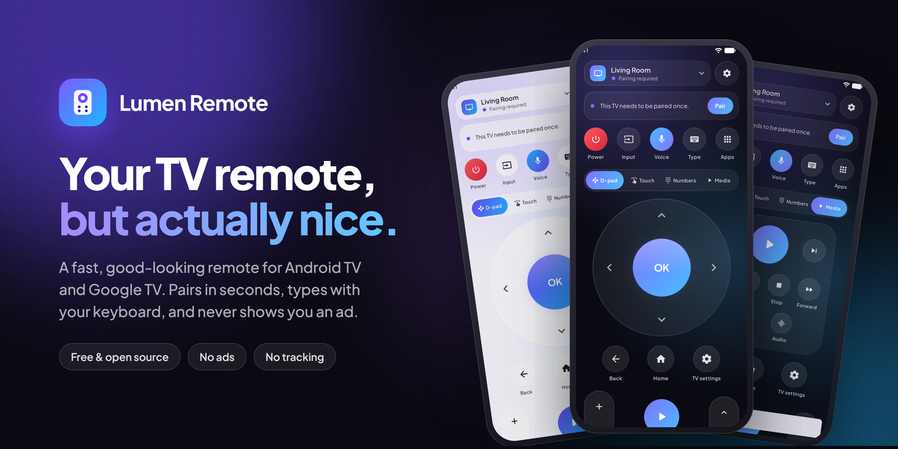
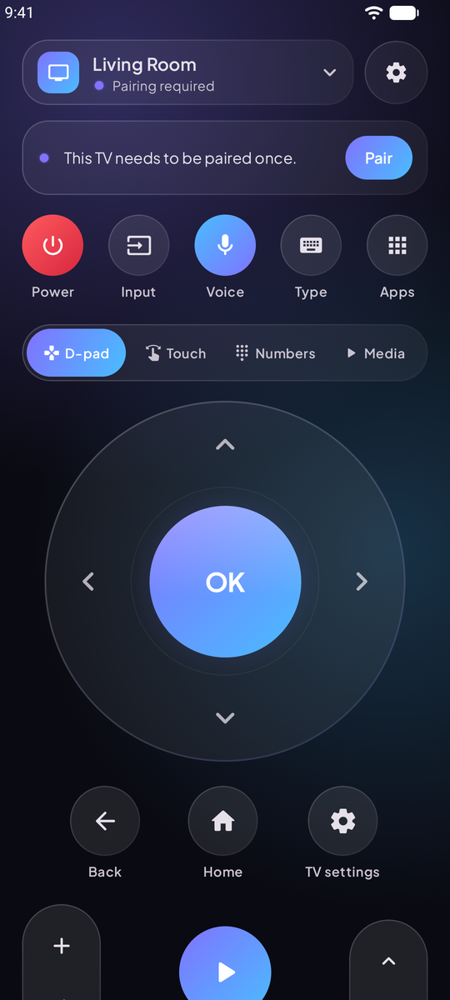
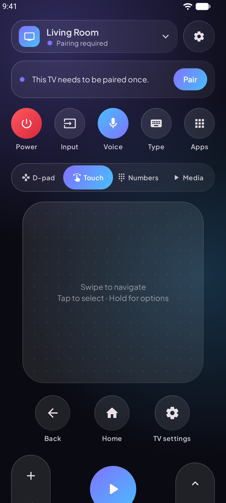
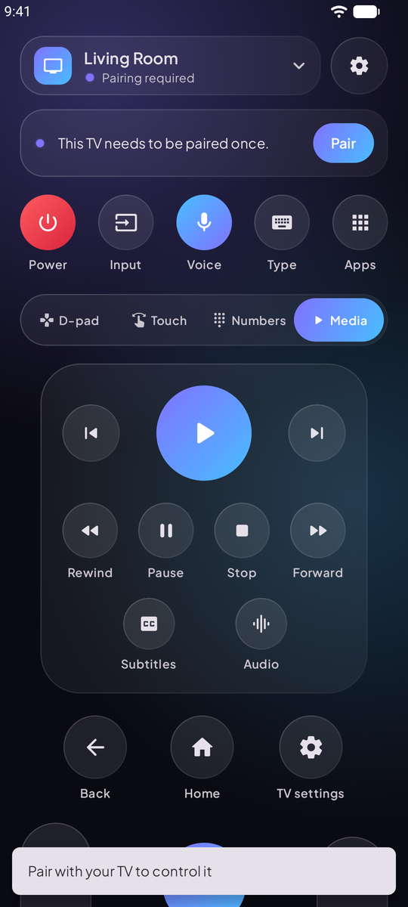
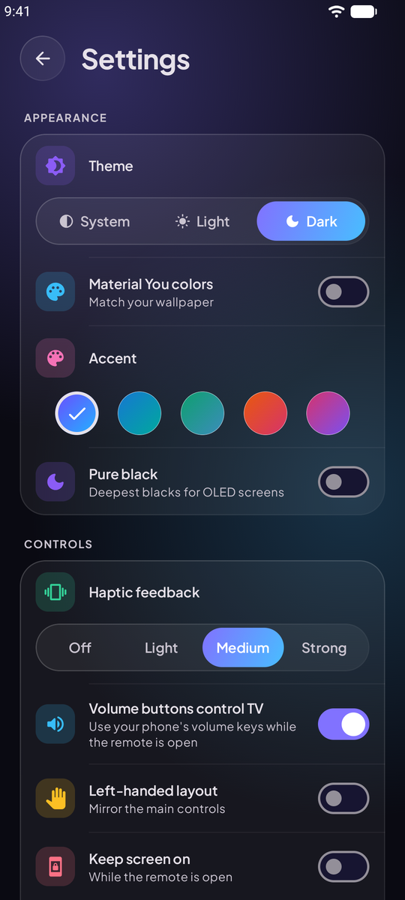
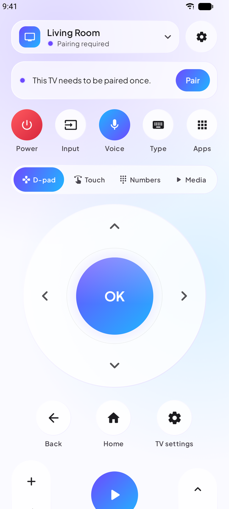
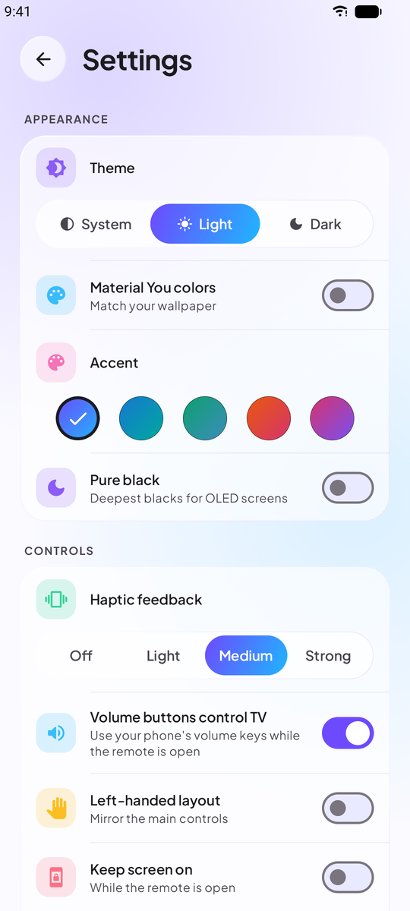
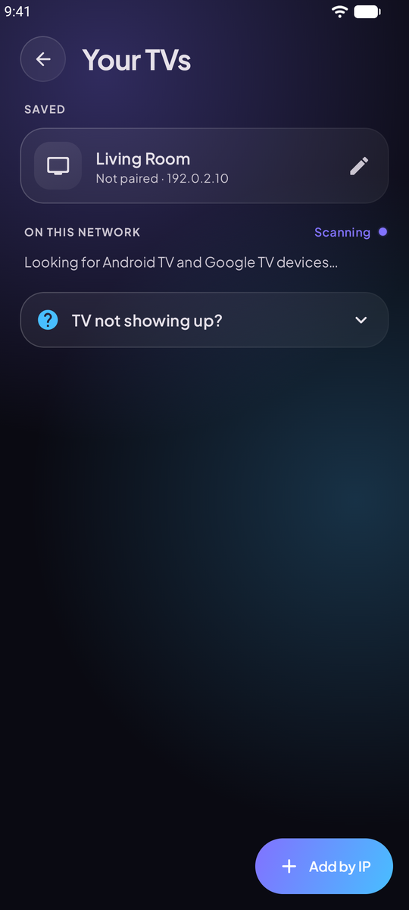
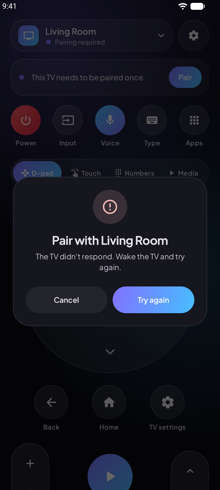

<p align="center">
  
</p>

<p align="center">
  <a href="https://github.com/anand34577/lumen-remote/releases/latest"></a>
  <a href="https://github.com/anand34577/lumen-remote/actions/workflows/ci.yml"></a>
  
  <a href="LICENSE"></a>
</p>

# Lumen Remote

Lumen Remote turns your phone into a remote for any Android TV or Google TV. It's for the times you've lost the real remote between the sofa cushions, need to type a long Wi-Fi password, or just want something nicer to hold.

It talks to your TV directly over your home Wi-Fi using the same protocol as Google's own remote. You don't install anything on the TV, and there's no account or cloud service in between.

## Why another remote app?

Most TV remote apps on the Play Store are covered in ads, ask for permissions they don't need, or lose the connection every few minutes. I wanted one that:

- **Connects and stays connected.** It finds your TV by itself. If the TV gets a new IP address, or your phone drops off Wi-Fi for a moment, it reconnects without you noticing.
- **Makes typing painless.** When the TV shows a search box, your phone keyboard opens by itself. Paste passwords, or just say what you're looking for.
- **Feels good to use.** The D-pad glows where you press it and the haptics are tuned, and holding a button repeats it the way a real remote does.
- **Respects you.** No ads, no tracking, no account. The code is right here.

## Features

<table>
<tr>
<td width="50%" valign="top">

**Control**
- D-pad with hold-to-repeat and long-press
- Touchpad mode: swipe to move, tap to select
- Number pad and full media controls
- Volume slider that jumps straight to a level
- Your phone's volume buttons control the TV
- Power on from standby with Wake-on-LAN

</td>
<td width="50%" valign="top">

**Convenience**
- Keyboard and paste, opens automatically
- Voice search typed straight onto the TV
- "Now on TV" card with one-tap pin to shortcuts
- App shortcuts and macros (button sequences)
- Notification remote, home screen widget and Quick Settings tile
- Several TVs, switch with one tap

</td>
</tr>
<tr>
<td valign="top">

**Make it yours**
- Dark, light or system theme
- Five accent colors, or Material You
- Pure black mode for OLED screens
- Left-handed layout
- Pick which sections show on the remote

</td>
<td valign="top">

**Built carefully**
- Encrypted, paired connection: each TV trusts only your phone's own key
- Clear help when the TV can't be found
- Works on Android 8.0 and newer, ready for Android 17
- About 4 MB

</td>
</tr>
</table>

## Screenshots

<p align="center">
  
  
  
  
</p>
<p align="center">
  
  
  
  
</p>

## Install

1. Download `LumenRemote-vX.Y.Z.apk` from the [latest release](https://github.com/anand34577/lumen-remote/releases/latest) on your phone.
2. Open it. Android will ask you to allow installs from your browser or file manager the first time.
3. Open Lumen Remote, pick your TV, and type the code it shows on screen. That's it.

Each release also has a `.sha256` file if you'd like to check the download.

## Works with

Any TV or streaming box running Android TV or Google TV: Sony Bravia, TCL, Hisense, Philips, Xiaomi Mi Box, Chromecast with Google TV, Google TV Streamer, Nvidia Shield and more. Your phone and TV need to be on the same network.

It doesn't work with Fire TV, Roku, Samsung Tizen or LG webOS. They use different systems.

## When something doesn't work

**The TV doesn't show up.** Make sure both are on the same Wi-Fi (not a guest network) and the TV is on. Some routers block devices from seeing each other; the in-app help explains what to check. You can always add the TV by its IP address, which you'll find in the TV's network settings.

**No code appears on the TV.** Tap "No code on TV? Show a new one". Some TVs skip the popup if an earlier attempt was cancelled.

**Power on doesn't work.** Many TVs turn off Wi-Fi in standby. Turn on "Wake on LAN" or "Remote start" in the TV's settings, and add the TV's MAC address in Lumen Remote (tap the pencil next to the TV in *Your TVs*).

Still stuck? [Open an issue](https://github.com/anand34577/lumen-remote/issues/new/choose) and mention your TV model.

## Privacy

Lumen Remote has no servers and collects nothing. Everything happens between your phone and your TV. Details are in [PRIVACY.md](PRIVACY.md).

## Building from source

You need JDK 17 and the Android SDK.

```bash
git clone https://github.com/anand34577/lumen-remote.git
cd lumen-remote
./gradlew assembleDebug       # app/build/outputs/apk/debug/app-debug.apk
./gradlew testDebugUnitTest   # unit tests
```

The app is Kotlin and Jetpack Compose. The Android TV Remote protocol is implemented from scratch in `app/src/main/java/com/lumen/tvremote/protocol`, so there's no protobuf code generation. See [CONTRIBUTING.md](CONTRIBUTING.md) for a tour of the code and how releases are signed.

## Contributing

Bug reports are very welcome, especially from TV models that behave oddly. Pull requests too; please read [CONTRIBUTING.md](CONTRIBUTING.md) first.

## License

[Apache License 2.0](LICENSE). Android, Android TV and Google TV are trademarks of Google LLC. This project isn't affiliated with Google.
